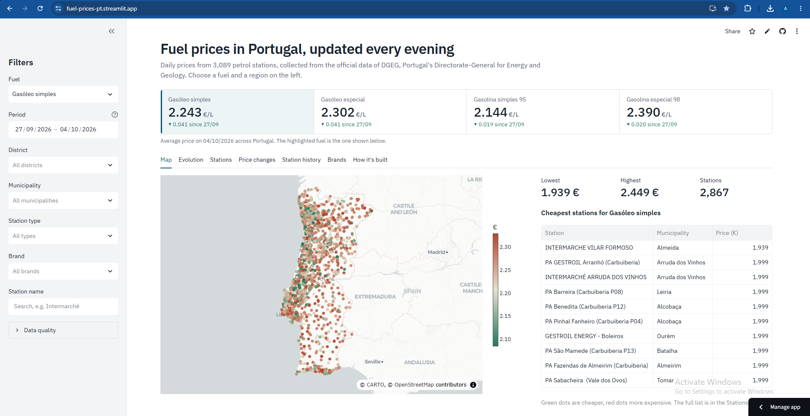
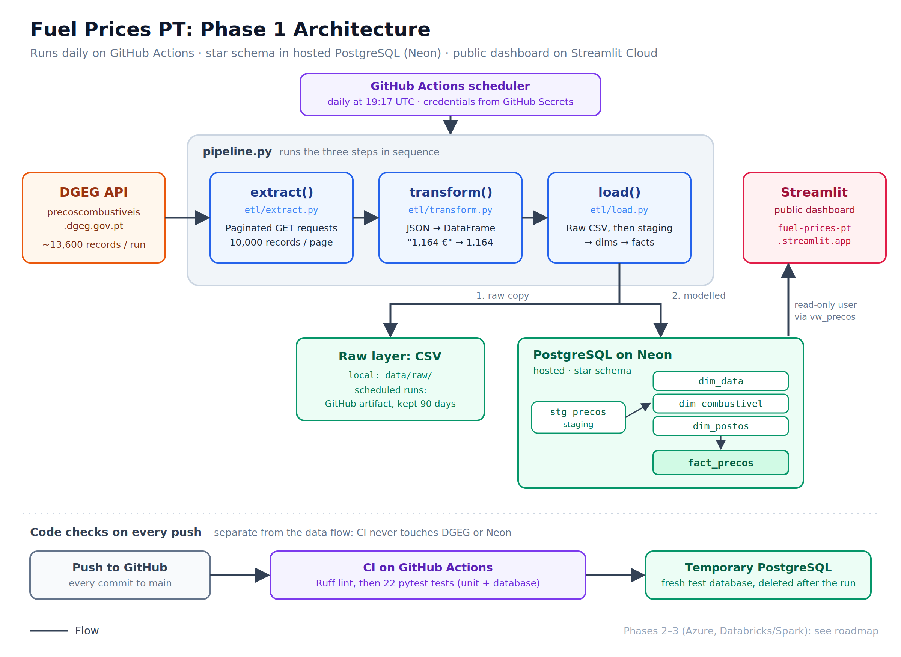
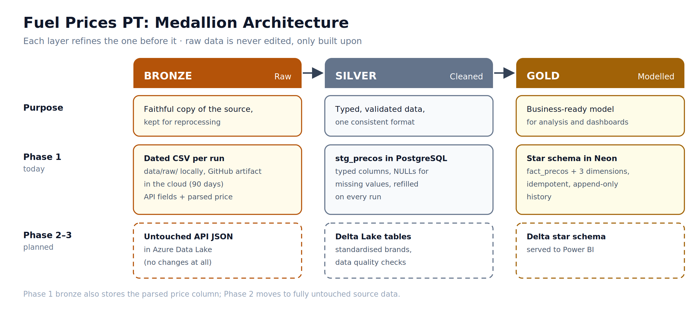
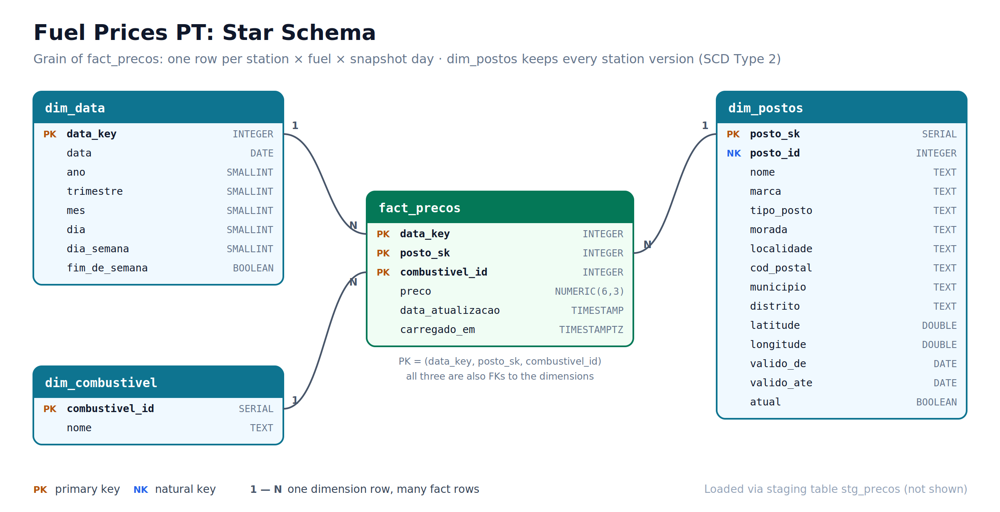
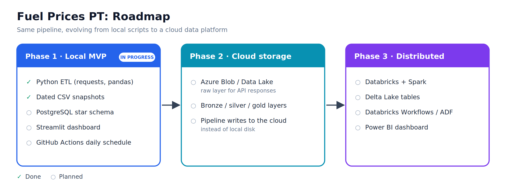

# Fuel Prices PT

[](https://fuel-prices-pt.streamlit.app/) [](https://github.com/amffpsa24-art/DE-Project---fuel-prices-pt/actions/workflows/ci.yml)

**Live dashboard: [fuel-prices-pt.streamlit.app](https://fuel-prices-pt.streamlit.app/)**



A daily data pipeline that collects the price of every fuel at every petrol station in Portugal and stores it in a PostgreSQL data warehouse. The official source only shows today's prices, so this project builds the price history that nobody else keeps.

It runs by itself every day on GitHub Actions, and a public Streamlit dashboard reads the data.



## Why this project

Portugal's energy authority, DGEG, publishes the current fuel price at every station on [precoscombustiveis.dgeg.gov.pt](https://precoscombustiveis.dgeg.gov.pt). But it only shows the **current** price: when a station changes its price, the old one is gone.

This pipeline saves a snapshot every day. Over time that becomes a historical dataset, which answers questions the website can't, like how prices change by brand, region or station.

I built it as a portfolio project to practise the full life of a data pipeline: finding the data, extracting it, cleaning it, storing it, modelling it, scheduling it and showing it.

## Data source

The DGEG website has no public API documentation. I found the endpoint the site uses internally by watching its network traffic in the browser's DevTools:

```
GET https://precoscombustiveis.dgeg.gov.pt/api/PrecoComb/PesquisarPostos
```

What I learned about it (full notes, in Portuguese, in [`notes/api-discovery.md`](notes/api-discovery.md), and the exploration in [`notebooks/dgeg_client.ipynb`](notebooks/dgeg_client.ipynb)):

- Each record is one **station + fuel** pair. A station that sells 4 fuels appears 4 times.
- One request can return the whole country (about 13,500–14,200 records a day).
- Asking for smaller pages caused problems: the sort order isn't stable, so some rows appeared twice and others were skipped. One big page avoids that.
- Prices come as Portuguese text (`"1,164 €"`) and have to be converted to numbers.

The data belongs to DGEG. Their terms allow personal, non-commercial use. This is a non-commercial learning project and makes as few requests as possible (usually one a day).

## How it works

The pipeline follows **extract → transform → load (ETL)**. Each step has its own file and class:

| Step | File | What it does |
|---|---|---|
| Extract | [`etl/extract.py`](etl/extract.py) | Downloads all records from the DGEG API, retrying if DGEG is temporarily down |
| Bronze | [`etl/bronze.py`](etl/bronze.py) | Saves DGEG's answer exactly as it came, locally and in Azure Blob Storage |
| Transform | [`etl/transform.py`](etl/transform.py) | Turns the JSON into a pandas table and converts prices to numbers |
| Quality checks | [`etl/quality.py`](etl/quality.py) | Stops a bad day before it reaches the database |
| Load | [`etl/load.py`](etl/load.py) | Loads the data into PostgreSQL |
| Run log | [`etl/runs.py`](etl/runs.py) | Records every run in a `pipeline_runs` table |
| Orchestration | [`pipeline.py`](pipeline.py) | Runs all the steps in order |
| Scheduling | [`daily.yml`](.github/workflows/daily.yml) | Runs the pipeline every day on GitHub Actions |
| Monitoring | [`monitor.py`](monitor.py) | Checks every evening that the day was loaded, and opens a GitHub issue if not |
| Testing | [`ci.yml`](.github/workflows/ci.yml) | Checks the code and runs the tests on every push |
| Backfill | [`backfill.py`](backfill.py) | Rebuilds the warehouse from the saved raw data |
| Dashboard | [`dashboard/`](dashboard/) | Public Streamlit app that reads the warehouse |

Each class gets its settings when it's created, and `Pipeline` receives the steps it runs instead of creating them. This makes testing easy: a test can give it a fake extractor or a test database.

**Naming:** the code is in English. Names that come from DGEG or the database (`Preco`, `distrito`, `fact_precos`) stay in Portuguese, so they match the data.

Example run (timestamps removed):

```
INFO    pipeline: Run 2 started (schedule) for 2026-10-11
INFO    etl.extract: Page 1: 13479 records (total: 13479 / 13479)
INFO    pipeline: Extract complete: 13479 records
INFO    etl.bronze: Saved 13479 raw records to data/bronze/dgeg_pesquisar_postos/date=2026-10-11/dgeg_2026-10-11T141802.jsonl.gz
INFO    pipeline: Transform complete: 13479 rows, 16 columns
INFO    etl.quality: Quality checks passed: 13479 rows
INFO    etl.load: Staged 13479 rows in stg_precos
INFO    etl.load: Loaded PostgreSQL: 13479 price rows for 2026-10-11
INFO    pipeline: Run 2 finished: 13479 price rows loaded
```

## Data layers (medallion architecture)



The data moves through three layers. Each one builds on the one before, and the raw layer is never edited:

| Layer | What it holds | Where it is today |
|---|---|---|
| **Bronze** | The raw data, exactly as DGEG sent it | One compressed JSON file per run in Azure Blob Storage (since 2026-10-31; before that, a CSV per run) |
| **Silver** | Cleaned data with proper types | `stg_precos`, a staging table in PostgreSQL, refilled on every run |
| **Gold** | Data modelled for analysis | The star schema in PostgreSQL (Neon) |

The bronze layer went to Azure first because it was the most urgent: DGEG keeps no history and GitHub deletes old files after 90 days. The old CSVs are copied to Azure by [`archive-artifacts.yml`](.github/workflows/archive-artifacts.yml).

If the warehouse ever needs to be rebuilt, [`backfill.py`](backfill.py) reloads it from the bronze files (and from the old CSVs for days before 2026-10-31). It runs the same transform and quality checks as the daily run, one day at a time, oldest first.

## Automation

The pipeline runs every day on **GitHub Actions** and writes to a hosted **PostgreSQL database on [Neon](https://neon.com)**, so no computer of mine needs to be on.

- **Schedule.** A main run at 10:17 UTC and a backup at 13:17 UTC. GitHub often starts scheduled jobs hours late, so both are early enough to finish the same day. The backup does nothing if the day is already loaded. Runs can also be started by hand.
- **Run log.** Every run is recorded in `pipeline_runs`: when it ran, who started it, whether it worked, how many rows it loaded and any error.
- **Missing-day alert.** If no run happens at all, GitHub sends no email. So every evening [`monitor.py`](monitor.py) checks that the day was loaded. If not, it opens a GitHub issue saying what went wrong and whether DGEG is currently up. A later check closes the issue if the day was loaded after all.
- **Quality checks.** Before anything is loaded, the day must have 12,000–16,000 rows, all the needed columns, no empty key fields, prices between 0.50 and 5.00 €, and no duplicates. If any check fails, the run stops and nothing reaches the warehouse.
- **Retries.** If DGEG is down or slow, the request is retried 3 times (after 30 seconds, 2 minutes and 5 minutes). If that still fails, the backup run tries later.
- **Raw data is never lost.** DGEG's answer is saved to Azure right after the download, before anything else can fail. If the upload fails twice, the run fails and the backup run tries again. The day's file is also kept on GitHub for 90 days either way.
- **Secrets.** Database and Azure credentials are stored in GitHub Secrets, never in the code.
- **Safe reruns.** Running the pipeline twice on the same day never creates duplicate data.
- **Pinned dependencies.** Every package has a fixed version. [Dependabot](.github/dependabot.yml) suggests updates once a week, and the tests run on each one before it's merged.
- **Correct dates.** The job runs in the `Europe/Lisbon` time zone, so each snapshot gets the Portuguese date.

## Testing

Every push runs the [CI workflow](.github/workflows/ci.yml): Ruff checks the code style, then pytest runs the tests.

| Tests | What they check |
|---|---|
| [`test_transform.py`](tests/test_transform.py) | Prices are converted correctly (`"1,164 €"` → `1.164`) and bad values fail loudly |
| [`test_extract.py`](tests/test_extract.py) | Downloading, retries and error handling, using a fake API (the tests never call DGEG) |
| [`test_bronze.py`](tests/test_bronze.py) | Raw data is saved exactly as received, files are never overwritten, a failed upload is retried once |
| [`test_quality.py`](tests/test_quality.py) | A normal day passes, and each kind of bad data fails |
| [`test_load.py`](tests/test_load.py) | Loading into a real PostgreSQL: correct data, no duplicates on rerun, station history, nothing kept if a load fails |
| [`test_pipeline.py`](tests/test_pipeline.py) | The run log, the backup run, and bad or empty days never reaching the database |
| [`test_backfill.py`](tests/test_backfill.py) | Rebuilding from bronze files and old CSVs, in date order, skipping days that failed the checks |
| [`test_monitor.py`](tests/test_monitor.py) | The evening check finds missing days and reports why |

The database tests use a separate test database and refuse to run against any database whose name doesn't end in `_test`, so the real data is never touched.

**Testing the tests.** To check that the tests catch real bugs, I broke the loading SQL on purpose. One change (`IS DISTINCT FROM` → `<>`) still passed every test, because in SQL a comparison with NULL never counts as "different". I added a test for that case, and it now fails when the code is broken.

**Running the tests locally**

```bash
pip install -r requirements-dev.txt
psql -U postgres -c "CREATE DATABASE fuel_prices_test ENCODING 'UTF8';"
ruff check .
pytest -v
```

Without a test database, the database tests are skipped and the others still run. To use another database, set `TEST_DATABASE_URL` (its name must end in `_test`).

## Dashboard

The [live dashboard](https://fuel-prices-pt.streamlit.app/) shows today's average prices, and lets you filter by fuel, period, district, municipality, brand or station:

- **Map** of every station, coloured from cheapest to most expensive, with the 10 cheapest alongside
- **Evolution** of average prices over time
- **Stations**: the full list, downloadable as CSV
- **Price changes** since the previous snapshot
- **Station history**: one station's prices and details over time
- **Brands**: average price per brand
- **How it's built**: the pipeline behind the data

How it reads the data:

- It uses a **read-only database user** ([`dashboard_role.sql`](sql/dashboard_role.sql)) that can only read, never change anything.
- It reads from one **view**, [`vw_precos`](sql/views.sql), which joins the star schema into one table.
- **Filters run in SQL**, so only the rows needed reach the app.
- Results are **cached for an hour**, since the data only changes once a day.

## Data model



A **star schema** in PostgreSQL ([`sql/schema.sql`](sql/schema.sql)): one fact table with the prices, and three dimension tables that describe them.

| Table | One row is | Key |
|---|---|---|
| `fact_precos` | one station × fuel × day | (`data_key`, `posto_sk`, `combustivel_id`) |
| `dim_postos` | one **version** of a station (see below) | `posto_sk` |
| `dim_combustivel` | one fuel type | `combustivel_id` |
| `dim_data` | one calendar day | `data_key`, e.g. `20261004` |

Every station's price is stored every day, even when it hasn't changed, so "what was the price on day X?" is a simple lookup.

Each run copies the day's data into a staging table, then [`sql/load_from_staging.sql`](sql/load_from_staging.sql) fills the dimensions first and the fact table after.

### Station history (SCD Type 2)

Stations change: a GALP becomes a PRIO, or a station is renamed. Instead of overwriting the old details, `dim_postos` closes the old row and adds a new **version**. This is called a *slowly changing dimension, Type 2*. Every price stays linked to the station details that were true on that day.

| posto_sk | posto_id | marca | valido_de | valido_ate | atual |
|---|---|---|---|---|---|
| 1 | 94625 | GALP | 2026-09-27 | 2026-10-03 | false |
| 3 | 94625 | PRIO | 2026-10-04 | 9999-12-31 | true |

*(example)*

- `posto_sk` is a new ID for each version. `posto_id` is DGEG's station ID, the same for all versions.
- Changes are found by comparing each column with `IS DISTINCT FROM`, which handles empty values (NULL) correctly.
- The database allows only one current version (`atual = true`) per station.
- Days must be loaded in date order. The daily run always does this, and `backfill.py` sorts its files.

### Design decisions

- **No duplicates.** The fact table's key is (day, station, fuel), and inserts skip rows that already exist.
- **All or nothing.** Each run loads in one transaction: if any step fails, nothing from that run is kept.
- **Two dates per price.** `data_key` is when the pipeline saved the price; `data_atualizacao` is when the station last changed it. An old `data_atualizacao` means the price may be out of date.
- **Exact prices.** Prices are stored as `NUMERIC(6,3)`, not floats, so there are no rounding errors.

### Example query

Average simple diesel price per district, on the latest day:

```sql
SELECT distrito, ROUND(AVG(preco), 3) AS preco_medio, COUNT(*) AS postos
FROM vw_precos
WHERE combustivel = 'Gasóleo simples'
  AND data = (SELECT MAX(data) FROM vw_precos)
GROUP BY distrito
ORDER BY preco_medio;
```

Result for 2026-10-04 (cheapest and most expensive districts):

| distrito | preco_medio (€/L) | postos |
|---|---:|---:|
| Braga | 2.226 | 240 |
| Aveiro | 2.227 | 232 |
| Leiria | 2.230 | 211 |
| ... | ... | ... |
| Beja | 2.258 | 78 |
| Lisboa | 2.260 | 343 |
| Bragança | 2.262 | 72 |

The difference between Braga and Bragança is 3.6 cents per litre, about 1.80 € on a 50-litre tank.

### Data quality notes

- **Old prices.** A few prices haven't been updated by their station in over a year (16 of 13,627 on 2026-10-04). They are kept as DGEG reports them.
- **Missing day.** There is no snapshot for **2026-10-05**: GitHub started that run after midnight, so it was saved as the next day. DGEG keeps no history, so it can't be recovered. The earlier schedule and the evening alert now prevent this.
- **Duplicated rows (found 2026-10-16).** When the pipeline downloaded in two pages, some rows were repeated and others skipped. The duplicate check caught it, and the pipeline now downloads everything in one request. Snapshots from before 2026-10-11 may be missing a few prices.
- **Portuguese characters.** Everything is stored in UTF-8. If Excel shows `ç` instead of `ç` when you open a CSV, open it with **Data → From Text/CSV** and choose **65001: Unicode (UTF-8)**.

## Roadmap



The full history of changes is in the [changelog](CHANGELOG.md).

**Phase 1: MVP** *(complete)*
- [x] Discover and document the DGEG API
- [x] ETL in Python (requests, pandas)
- [x] Daily CSV snapshots
- [x] PostgreSQL star schema with safe reruns
- [x] Station history with SCD Type 2
- [x] Hosted database (Neon) + daily scheduling with GitHub Actions
- [x] Public Streamlit dashboard

**Production readiness** *(in progress)*
- [x] Tests (pytest) with CI on every push
- [x] Data quality checks that stop a bad load
- [x] Run log and a backup run
- [x] Retries and proper logging
- [x] One class per ETL step, easy to test
- [x] Evening alert when a day is missing
- [x] Better handling of DGEG outages

**Phase 2: Cloud storage**
- [x] Bronze layer in Azure (raw API responses)
- [ ] Separate bronze / silver / gold layers

**Phase 3: Distributed processing**
- [ ] Databricks + Spark
- [ ] Delta Lake tables
- [ ] Orchestration with Databricks Workflows or Azure Data Factory
- [ ] Power BI dashboard
- [ ] Move the long-term history out of Neon (it grows about 600 MB a year)

## Project structure

```
├── .github/workflows/
│   ├── daily.yml               # daily schedule
│   ├── monitor.yml             # evening check for missing days
│   ├── archive-artifacts.yml   # one-off: copies old files to Azure
│   └── ci.yml                  # lint + tests on every push
├── dashboard/
│   ├── app.py                  # Streamlit dashboard: layout, sidebar and tabs
│   ├── queries.py              # every database read, cached
│   └── charts.py               # colours, theme and chart helpers
├── etl/
│   ├── extract.py              # download from the DGEG API
│   ├── bronze.py               # save and read the raw data (local + Azure)
│   ├── transform.py            # clean and convert
│   ├── quality.py              # quality checks
│   ├── load.py                 # load PostgreSQL
│   └── runs.py                 # run log
├── sql/
│   ├── schema.sql              # star schema tables
│   ├── load_from_staging.sql   # staging → dimensions → fact table
│   ├── views.sql               # vw_precos view
│   └── dashboard_role.sql      # read-only user for the dashboard
├── tests/                      # pytest tests
├── notebooks/                  # first API exploration
├── notes/                      # API discovery notes
├── docs/images/                # diagrams and screenshot
├── pipeline.py                 # runs the full ETL
├── backfill.py                 # rebuilds the warehouse from the raw data
├── monitor.py                  # checks if the day was loaded
├── CHANGELOG.md                # history of changes
├── .env.example                # template for database settings
├── requirements.txt            # pipeline dependencies
└── requirements-dev.txt        # + pytest and Ruff
```

The `data/` folder is created when the pipeline runs and isn't committed to Git.

## How to run

You need Python 3.14 and PostgreSQL (tested with version 18 locally, and with Neon).

**1. Get the code and install dependencies**

```bash
git clone https://github.com/amffpsa24-art/DE-Project---fuel-prices-pt.git
cd DE-Project---fuel-prices-pt

python -m venv .venv
# Windows (PowerShell)
.venv\Scripts\Activate.ps1
# macOS / Linux
source .venv/bin/activate

pip install -r requirements.txt
```

**2. Set up the database**

Use a local PostgreSQL or a hosted one like Neon:

```bash
psql -U postgres -c "CREATE DATABASE fuel_prices ENCODING 'UTF8';"   # local only
psql "<your connection string>" -f sql/schema.sql
psql "<your connection string>" -f sql/views.sql
```

Copy `.env.example` to `.env` and fill in your connection settings. For a hosted database, add `PGSSLMODE=require`.

**3. Run**

```bash
python pipeline.py    # today's snapshot
python backfill.py    # optional: rebuild from data/bronze/ (and old CSVs in data/raw/)
```

Both are safe to run more than once.

**4. Optional: run the dashboard**

```bash
pip install -r dashboard/requirements.txt
streamlit run dashboard/app.py
```

Copy `.streamlit/secrets.toml.example` to `.streamlit/secrets.toml` and fill it in (ideally with the read-only user from [`sql/dashboard_role.sql`](sql/dashboard_role.sql)). In **GitHub Codespaces**, everything is installed for you and the file is created from the template.

**5. Optional: schedule it on your own fork**

Add these secrets under **Settings → Secrets and variables → Actions**: `PGHOST`, `PGUSER`, `PGPASSWORD` and `PGDATABASE`. The daily workflow will then run on its own.

For the Azure bronze layer, also:

1. Create a storage account (with **hierarchical namespace** on) and a container named `bronze`.
2. Create a **SAS key** (Security + networking → Shared access signature) with only **Blob**, **Object** and **Read, Write, Create** permissions. Don't use the account key: it can also delete files. Set an expiry date and remember to renew it.
3. Copy the **connection string** into a secret named `AZURE_STORAGE_CONNECTION_STRING`.
4. Turn on **soft delete for blobs** so deleted files can be restored.

Without the Azure secret, the pipeline still runs and keeps the raw data on GitHub only.

## Tech stack

**Now:** Python, pandas, requests, SQL, PostgreSQL, Neon, Azure Blob Storage, GitHub Actions, Streamlit, Plotly, pytest, Ruff, Git
**Planned:** Databricks, Spark, Delta Lake, Power BI

## Author

**André Francisco**: mechanical engineer (MSc, Instituto Superior Técnico).
[LinkedIn](https://www.linkedin.com/in/your-profile) · [GitHub](https://github.com/amffpsa24-art)
